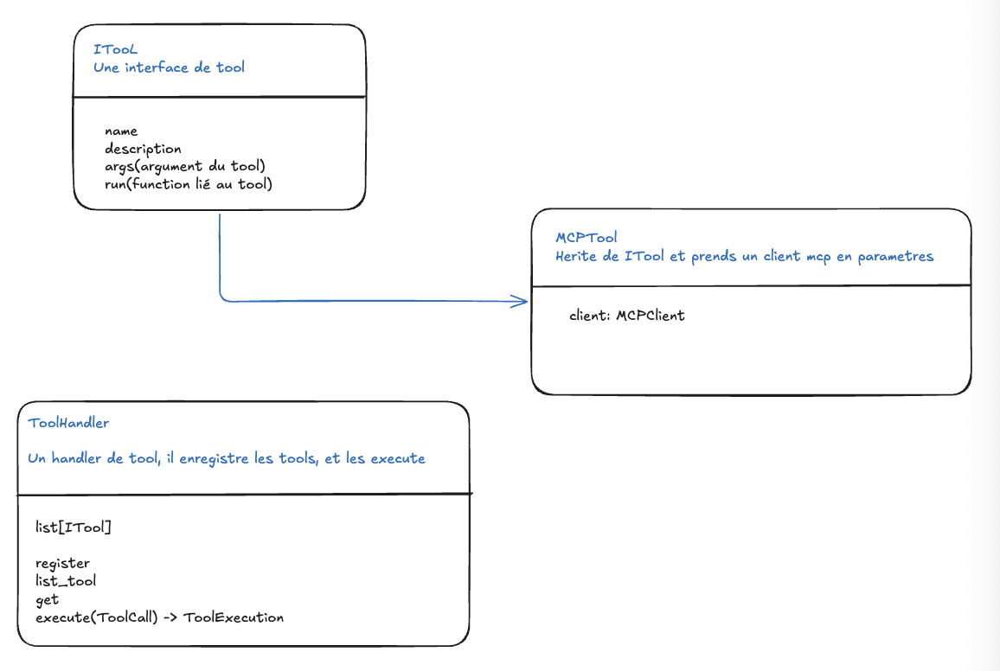
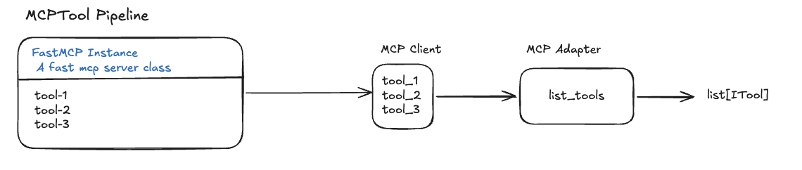

# MCP tools

Remote MCP tools are exposed to the agent through the same `ITool` contract as local tools. A `FastMCP` server declares the tools. The MCP client talks to that server. The adapter turns each remote tool into an `MCPTool`. `ToolHandler` then registers and runs those tools.

## Tools architecture



### ITool

`ITool` (`src/core/tools.py`) is the tool interface. Every tool, local or remote, implements:

- `name`: tool identifier
- `description`: what the tool does
- `args`: the tool arguments
- `run`: the function bound to the tool

### MCPTool

`MCPTool` (`adapter.py`) inherits from `ITool` and takes an `MCPClient` in its constructor. It stores that client and forwards `run` to `MCPClient.call_tool`, so a remote MCP tool behaves like any other `ITool`.

### ToolHandler

`ToolHandler` (`src/core/tools.py`) registers tools and executes them. It keeps a `list[ITool]` and exposes:

- `register`: add one tool
- `list_tools`: return the registered tools
- `get`: look up a tool by name
- `execute(ToolCall) -> ToolExecution`: run a tool call and return its result

## MCP tool pipeline



1. A `FastMCP` instance is the MCP server. It declares the tools (`tool-1`, `tool-2`, `tool-3`, ...) with `@mcp.tool`.
2. `MCPClient` (`client.py`) wraps that server. Its `list_tools()` returns the tools exposed by the server, and its `call_tool()` runs one of them.
3. `MCPAdapter.list_tools()` (`adapter.py`) wraps each tool in an `MCPTool`, passing the same `MCPClient`.
4. The result is a `list[ITool]`, which `ToolHandler.register_many` registers so the agent can execute them.

## Example

`src/tools/search/web.py` follows this pipeline to expose the web search tool:

```python
def create_search_server() -> FastMCP:
    mcp = FastMCP("sensai-search")

    @mcp.tool
    def search_web(query: str, max_results: int = 5) -> str:
        return run_web_search(query, max_results)

    return mcp


def register_search_tools(manager: ToolHandler) -> None:
    adapter = MCPAdapter(MCPClient(create_search_server()))
    manager.register_many(adapter.list_tools())
```
